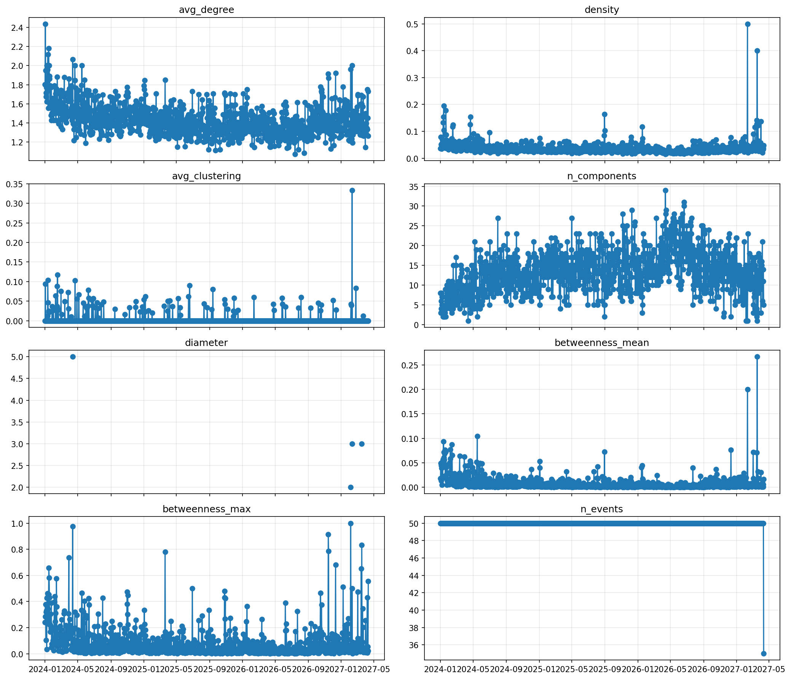
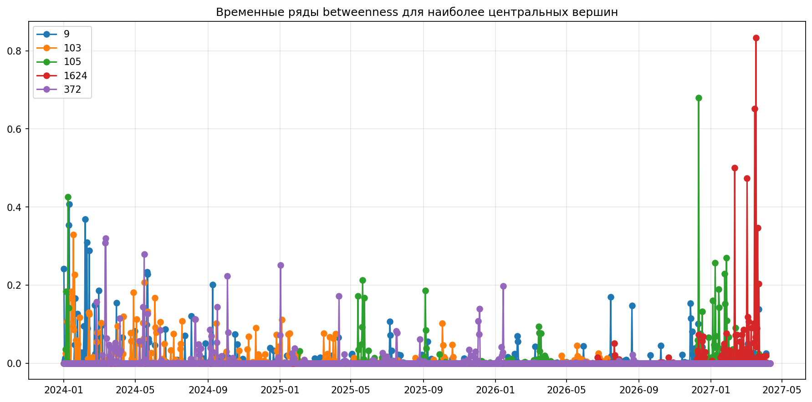
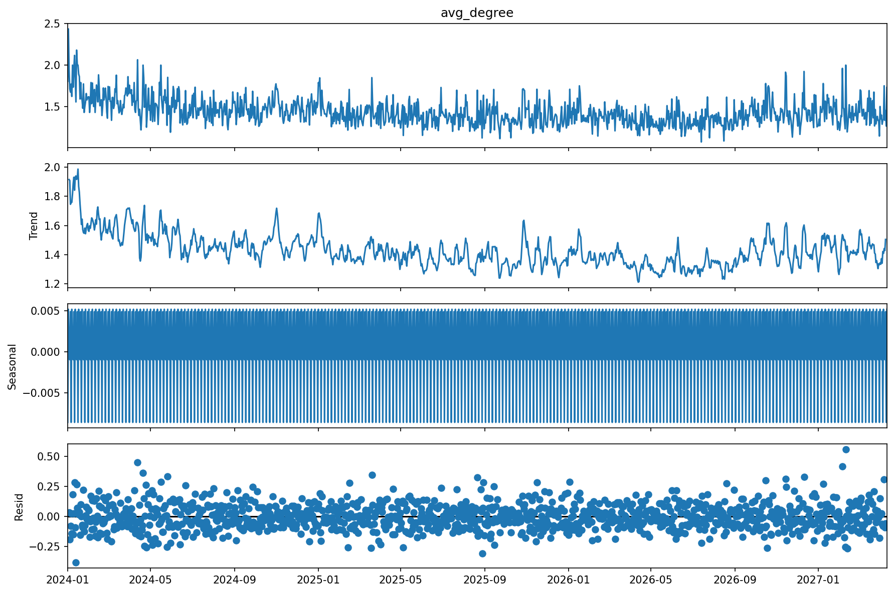
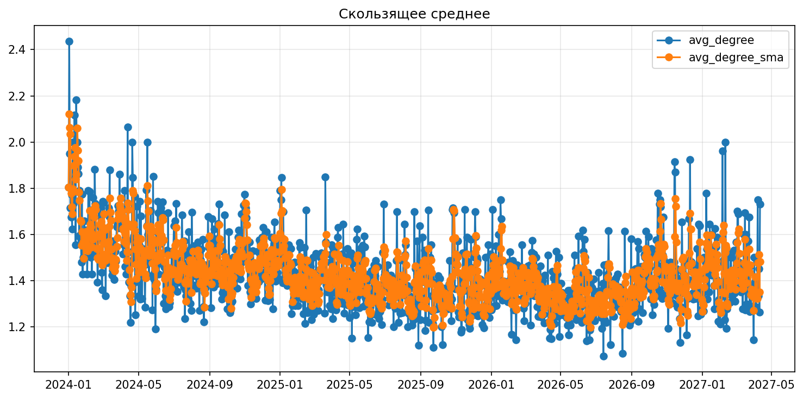
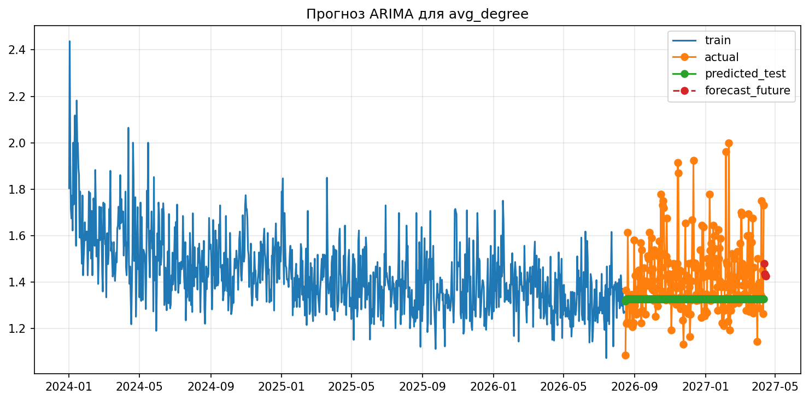

# Лабораторная работа №7

## Титульный лист

Дисциплина: **Разработка информационно-аналитических систем**  
Тема: **Аналитика графов и временных рядов**

Студент: ____________________  
Группа: ____________________  
Преподаватель: ____________________  
Дата: ____________________

## Цель работы

Изучить методы анализа динамических графов и временных рядов на реальном наборе событий взаимодействия между узлами, построить временные ряды графовых метрик, проверить их стационарность, выделить тренд и сезонность, а также выполнить простое прогнозирование.

## Краткое теоретическое обоснование

Граф описывает объекты и связи между ними. В динамическом графе структура меняется во времени, поэтому граф удобно анализировать как последовательность временных снимков. Для каждого снимка можно вычислять графовые характеристики: среднюю степень вершины, плотность, коэффициент кластеризации, число компонент связности, диаметр и центральность по посредничеству.

Временной ряд — это упорядоченная по времени последовательность значений. Для анализа рядов важны визуализация, проверка стационарности, декомпозиция на тренд, сезонность и остаток, а также прогнозирование. В работе использовались тест Дики–Фуллера, аддитивная декомпозиция, скользящее среднее и модель ARIMA.

## Постановка задачи

Требовалось:

1. Заменить синтетический датасет реальным.
2. Разбить временную шкалу на равные интервалы.
3. Для каждого окна построить граф.
4. Рассчитать графовые метрики.
5. Представить метрики в виде временных рядов.
6. Выполнить анализ временных рядов.
7. Добавить анализ центральности по посредничеству по вершинам.
8. Оценить корреляцию между двумя метриками.
9. Построить прогноз ARIMA и сравнить с фактическими значениями.
10. Для ориентированного графа исследовать соотношение `in/out` степеней и проверить его стационарность.

## Использованные данные

В качестве реального датасета выбран **CollegeMsg** из SNAP. Он содержит сообщения между пользователями университетской сети.

Характеристики датасета:

1. Число событий: **59 835**.
2. Число уникальных узлов: **1 899**.
3. Период наблюдения: **с 15.04.2004 по 26.10.2004**.
4. Формат данных: `source target timestamp`.
5. Размер временного окна: **7 дней**.
6. Количество окон: **28**.

Выбор недельного окна позволил одновременно сохранить регулярную шкалу времени и получить достаточно точек для декомпозиции и ARIMA.

## Структура проекта

Код лабораторной расположен в файлах:

1. `lab07.py` — точка входа.
2. `src/data_loader.py` — загрузка и нормализация событий.
3. `src/graph_metrics.py` — построение окон и расчёт графовых метрик.
4. `src/time_series_analysis.py` — анализ временных рядов и построение графиков.
5. `src/main.py` — orchestration всего пайплайна.

## Этапы анализа

### 1. Загрузка и подготовка данных

Ниже показан фрагмент кода загрузки реального датасета:

```python
def load_events_file(path: Path) -> pd.DataFrame:
    df = pd.read_csv(
        path,
        sep=r"\s+",
        header=None,
        names=["source", "target", "timestamp"],
        usecols=[0, 1, 2],
        compression="infer",
    )
    return _normalize_events(df)
```

После чтения временные метки были преобразованы в `datetime`, данные отсортированы по времени, а идентификаторы узлов приведены к строковому типу.

### 2. Разбиение на временные окна

В отличие от примера, где данные делились по количеству событий, в выполненной работе разбиение сделано **по равным интервалам времени**, что соответствует условию лабораторной.

```python
def split_into_time_windows(df: pd.DataFrame, window_size: str) -> list[TimeWindow]:
    window_delta = pd.Timedelta(window_size)
    timeline_start = df["timestamp"].min().normalize()
    delta = df["timestamp"] - timeline_start
    df["window_id"] = (delta // window_delta).astype(int) + 1
```

Для каждого окна строился отдельный граф-снимок.

### 3. Расчёт графовых метрик

Для каждого окна вычислялись:

1. `avg_degree`
2. `density`
3. `avg_clustering`
4. `n_components`
5. `diameter`
6. `betweenness_mean`
7. `betweenness_max`
8. Для ориентированного графа: `in_out_ratio_mean`

Ключевой фрагмент расчёта:

```python
graph = build_graph(window.chunk, directed=directed)
degrees = [degree for _, degree in graph.degree()]
avg_degree = float(np.mean(degrees)) if degrees else 0.0
density = float(nx.density(graph)) if len(graph) > 1 else 0.0
avg_clustering = _avg_clustering(graph)
n_components = _connected_components_count(graph)
diameter = _diameter(graph)
betweenness = nx.betweenness_centrality(graph) if len(graph) > 0 else {}
```

Дополнительно была создана отдельная таблица `betweenness_by_node.csv`, в которой для каждой вершины сохранён её временной ряд центральности по посредничеству.

### 4. Анализ временных рядов

Для временного ряда `avg_degree` выполнялись:

1. визуализация;
2. тест Дики–Фуллера;
3. декомпозиция;
4. сглаживание скользящим средним;
5. прогнозирование ARIMA.

```python
avg_degree_series = prepare_time_series(metrics_undirected.set_index("time")["avg_degree"])
adf_avg_degree = run_adf_test(avg_degree_series)
decomposition_ready = save_decomposition_plot(avg_degree_series, 4, output_path)
arima_result = fit_arima(avg_degree_series, (1, 1, 1), 4)
```

## Полученные результаты

### Сводные характеристики графов

Основные агрегированные результаты:

1. Средняя степень: **2.9706**, диапазон **1.3714 ... 7.5646**.
2. Средняя плотность: **0.0119**.
3. Средний коэффициент кластеризации: **0.0219**.
4. Среднее число компонент связности: **16.57**, диапазон **2 ... 26**.
5. Диаметр не удалось вычислить ни в одном окне, так как граф ни разу не оказался связным.
6. Среднее значение `betweenness_mean`: **0.0085**.
7. Среднее значение `in_out_ratio_mean`: **0.8953**.

Наиболее плотные окна по `avg_degree`:

| Окно | Интервал | avg_degree | density | n_components |
| --- | --- | ---: | ---: | ---: |
| 3 | 29.04.2004 - 06.05.2004 | 7.5646 | 0.0124 | 4 |
| 4 | 06.05.2004 - 13.05.2004 | 6.8658 | 0.0087 | 2 |
| 6 | 20.05.2004 - 27.05.2004 | 6.4058 | 0.0072 | 11 |

Окна с наибольшим числом компонент:

| Окно | Интервал | avg_degree | n_components |
| --- | --- | ---: | ---: |
| 20 | 26.08.2004 - 02.09.2004 | 1.9552 | 26 |
| 21 | 02.09.2004 - 09.09.2004 | 1.9195 | 25 |
| 14 | 15.07.2004 - 22.07.2004 | 1.9786 | 24 |

Это показывает ожидаемую зависимость: при уменьшении средней степени граф распадается на большее число компонент.

### Временные ряды метрик



Интерпретация:

1. В первых окнах сеть заметно плотнее, чем в конце наблюдения.
2. Начиная с лета, `avg_degree` и плотность в целом снижаются.
3. Число компонент, наоборот, возрастает.
4. Коэффициент кластеризации остаётся низким почти во всех окнах, то есть устойчивые локальные триады выражены слабо.
5. Отсутствие вычислимого диаметра во всех окнах означает, что сеть всё время остаётся несвязной.

### Центральность по посредничеству по вершинам

Для дополнительного задания была рассчитана центральность по посредничеству для **каждой вершины** в каждом окне.

Лидеры по среднему значению betweenness:

| Вершина | Средняя centrality |
| --- | ---: |
| 1624 | 0.067281 |
| 9 | 0.057146 |
| 105 | 0.054554 |
| 1713 | 0.052062 |
| 249 | 0.038244 |

Пиковые значения:

1. Вершина `1624`: максимум **0.388849** в окне с началом **16.09.2004**.
2. Вершина `9`: максимум **0.223955** в окне с началом **22.07.2004**.
3. Вершина `105`: максимум **0.258433** в окне с началом **12.08.2004**.



По графику видно, что ряд центральности отдельных вершин очень неравномерен: активные посредники возникают локально, а затем уступают место другим узлам.

### Проверка стационарности

Результаты теста Дики–Фуллера:

| Ряд | ADF statistic | p-value | Вывод |
| --- | ---: | ---: | --- |
| `avg_degree` | -2.9709 | 0.0377 | стационарный |
| `in_out_ratio_mean` | 1.5103 | 0.9976 | нестационарный |
| `betweenness` вершины `1624` | 2.3601 | 0.9990 | нестационарный |

Интерпретация:

1. `avg_degree` можно считать стационарным на уровне значимости 0.05.
2. Среднее отношение `in/out` степеней для ориентированного графа нестационарно.
3. Центральность конкретной вершины также нестационарна, так как влияние посредников заметно меняется от окна к окну.

### Декомпозиция ряда



Аддитивная декомпозиция показала:

1. Наличие общей нисходящей составляющей.
2. Небольшую повторяющуюся компоненту.
3. Остаточную часть с заметными колебаниями, связанными с изменениями активности пользователей.

### Скользящее среднее



Сглаживание окном `3` хорошо показывает общий спад средней степени к концу периода наблюдения и убирает краткосрочные колебания.

### Корреляция графовых метрик

Для дополнительного задания была рассчитана корреляция между `avg_degree` и `n_components`:

**corr(avg_degree, n_components) = -0.8042**

Это сильная отрицательная корреляция. Практический смысл очевиден: чем больше связей возникает в окне, тем меньше сеть распадается на отдельные компоненты.

### Прогнозирование ARIMA

Для ряда `avg_degree` построена модель **ARIMA(1,1,1)**.

Качество на отложенной выборке:

1. `MAE = 0.3539`
2. `RMSE = 0.3854`

Сравнение прогноза с фактическими значениями:

| Дата | Факт | Прогноз | Абс. ошибка |
| --- | ---: | ---: | ---: |
| 23.09.2004 | 1.9865 | 2.0867 | 0.1002 |
| 30.09.2004 | 1.8136 | 2.0704 | 0.2568 |
| 07.10.2004 | 1.6174 | 2.0739 | 0.4565 |
| 14.10.2004 | 1.6190 | 2.0732 | 0.4541 |
| 21.10.2004 | 1.5714 | 2.0733 | 0.5019 |

Прогноз на следующие 4 окна:

| Дата | Прогноз avg_degree |
| --- | ---: |
| 28.10.2004 | 1.4344 |
| 04.11.2004 | 1.4634 |
| 11.11.2004 | 1.4572 |
| 18.11.2004 | 1.4585 |



Вывод по прогнозу: модель правильно улавливает снижение уровня ряда, но на тестовых точках систематически завышает значения. Для реального набора с выраженной неоднородностью структуры такое качество можно считать удовлетворительным, но не высоким.

## Выводы

В ходе работы лабораторное задание выполнено полностью на реальном датасете `CollegeMsg`. Данные были корректно разбиты на **равные недельные интервалы времени**, а не просто на блоки фиксированного числа событий.

По результатам анализа можно сделать следующие выводы:

1. Структура сети со временем стала более разреженной: средняя степень и плотность в конце периода ниже, чем в начале.
2. При уменьшении количества связей число компонент связности растёт, что подтверждается сильной отрицательной корреляцией `-0.8042`.
3. Граф во всех окнах оставался несвязным, поэтому диаметр не вычислялся.
4. Коэффициент кластеризации оставался низким, следовательно устойчивые локальные группы выражены слабо.
5. Временной ряд `avg_degree` оказался стационарным, а ряды `in_out_ratio_mean` и betweenness вершины-лидера — нестационарными.
6. В сети регулярно появлялись вершины-посредники, однако их роль была нестабильной во времени.
7. Модель ARIMA дала рабочий, но умеренно точный прогноз: общий нисходящий тренд уловлен, однако ошибки на тестовой части заметны.

Таким образом, динамический анализ графовых метрик позволил выявить ослабление связности сети, рост фрагментации и переменную роль отдельных посреднических вершин.

## Ответы на контрольные вопросы

### 1. Что такое динамический граф и какими способами его можно представить в памяти?

Динамический граф — это граф, структура которого меняется во времени. Его можно хранить как последовательность снимков, как поток событий с временными метками, как граф с временными атрибутами или как многослойную структуру.

### 2. Какие графовые метрики наиболее информативны для отслеживания эволюции сети?

Наиболее полезны средняя степень, плотность, коэффициент кластеризации, число компонент связности, диаметр, центральность по посредничеству, а для ориентированных графов — входящие и исходящие степени и их отношение.

### 3. Как проверить стационарность временного ряда и зачем это нужно?

Стационарность проверяют тестом Дики–Фуллера, визуальным анализом, автокорреляцией и анализом тренда/сезонности. Это нужно, потому что многие модели прогнозирования предполагают неизменность статистических свойств ряда.

### 4. Что показывает тест Дики–Фуллера? Интерпретация p-value.

Тест Дики–Фуллера проверяет нулевую гипотезу о нестационарности ряда. Если `p-value < 0.05`, ряд считают стационарным. Если `p-value >= 0.05`, оснований отвергнуть нестационарность нет.

### 5. Чем отличаются аддитивная и мультипликативная модели декомпозиции?

Аддитивная модель складывает тренд, сезонность и остаток. Мультипликативная перемножает их. Аддитивная модель подходит, когда амплитуда сезонности примерно постоянна, мультипликативная — когда она зависит от уровня ряда.

### 6. Какие методы прогнозирования временных рядов вы знаете?

Скользящее среднее, экспоненциальное сглаживание, AR/MA/ARIMA/SARIMA, Prophet, регрессионные модели с временными признаками, а также нейросетевые методы вроде LSTM и трансформеров.
